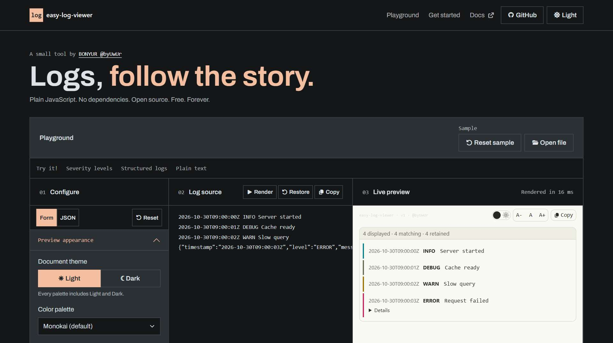

# byuwur/easy-log-viewer



**Logs, follow the story.**

Browse plain-text or structured logs with severity colors, search, timestamps, and expandable details. Append new entries as they arrive.

Use it for debug output, activity feeds, and log files where finding the relevant entry matters.

One JavaScript file. One scoped stylesheet. No build step. Plain JavaScript, with no runtime dependencies.

[Open the playground](https://byuwur.github.io/easy-log-viewer/)

Open `index.html` for the local playground; its page assets require internet access.

## Installation and usage

**Recommended: CDN.** No downloads or package manager.

```html
<link href="https://cdn.jsdelivr.net/gh/byuwur/easy-log-viewer@main/log.css" rel="stylesheet" />
<script src="https://cdn.jsdelivr.net/gh/byuwur/easy-log-viewer@main/log.js" defer></script>
<div id="viewer" data-theme="light"></div>
<script>
  document.addEventListener("DOMContentLoaded", () => {
    const logs = byLOGviewer(document.getElementById("viewer"), "INFO Server ready");
    logs.append({ level: "error", timestamp: "2026-10-30T09:00:00Z", message: "Request failed", status: 503 });
  });
</script>
```

The CDN example tracks `@main` and requires internet access. Use a published tag or commit to pin a version.

**Local files:** For offline use, save `log.js` and `log.css` beside your HTML:

```html
<link href="log.css" rel="stylesheet" />
<script src="log.js" defer></script>
```

Exported HTML starters use default settings, independently of playground changes.

## Input, parsing, and API

`byLOGviewer(element, input?, options?)` accepts text, a record, or an array of strings/records. Omitted input uses the target's text. Text splits on CR/LF/CRLF; a trailing newline adds no entry. Empty strings have no entries. JSON object lines are parsed; malformed JSON stays plain text.

The default parser recognizes a leading ISO-like timestamp with optional severity, or a leading severity with optional brackets. Supported levels: TRACE, DEBUG, INFO, WARN/WARNING, ERROR, and FATAL/CRITICAL. Other formats stay UNKNOWN; words inside messages are not treated as severity.

Timestamps retain their input text without timezone conversion. Text after the timestamp/severity becomes the message.

Records use `message`/`msg`, `level`/`severity`, and `timestamp`/`time`. Other own properties appear in Details. Missing messages display `(structured entry)`. Object messages/details become indented JSON; bigint values become strings and cycles become `[Circular]`. Original text/record JSON is retained for individual copy and source copy.

`byLOGviewer.parse(entry)` exposes the default single-entry parser and returns `{ message, level, timestamp, details? }`. Invalid entry types throw `TypeError`.

The controller also exposes `append(batch): Promise<boolean>`. Batches are queued in order and committed atomically. A failed batch displays an error, preserves earlier entries, and resolves `false`; later valid batches can recover.

Only the newest `maxEntries` are retained. Calling `append()` after disposal resolves false. The initial `ready` Promise belongs to the initial batch.

## Log options

| Option | Default | Behavior |
| --- | --- | --- |
| `layout` | `"inline"` | `"inline"` keeps metadata and message together when they fit; `"stacked"` places the message below its timestamp and severity. Invalid values use `"inline"`. |
| `parser` | built-in | Synchronous `(entry, index) => ({ message, level, timestamp, details })`; return null to skip. Index counts committed input entries, including skipped ones. A thrown error discards the batch; `append()` resolves `false`. |
| `search` | `false` | Case-insensitive substring search over source and parsed fields. |
| `autoScroll` | `false` | Show newest matching entries and scroll the internal log region to the bottom after changes. |
| `batchSize` | `200` | Entries shown initially/per Load more, integer 1–1000; invalid values use 200. |
| `maxEntries` | `10000` | Retained history size, integer 1–100000; invalid values use 10000. Oldest entries are discarded. |

Search and exact severity filtering combine with AND. Auto-scroll shows the newest display window; without it, Load more reveals older-to-newer entries.

The viewer does not tail files or open connections. Pass complete entries to `append()`; text chunks are not joined. Supply each stack trace or multiline event as one array string or record. Use `parser` for syslog, custom timestamps, or numeric severity conventions.

Text batches are limited to 10 million characters and 100,000 entries. Parsing/filtering yield; record serialization and rendering each display batch are synchronous. History is bounded by entry count, not bytes; bound individual record sizes in your application. Source copy includes retained hidden entries, but cannot recover discarded history.

## Shared controls and lifecycle

| Option | Default | Behavior |
| --- | --- | --- |
| `toolbar` | `true` | Show the viewer header; secondary tools are configured separately. |
| `credits` | `true` | Show attribution in the header. |
| `statusBar` | `true` | Show counts and metadata. Loading, errors, and empty results remain visible. |
| `levelFilter` | `false` | Show the severity filter. |
| `autoScrollControl` | `false` | Show the auto-scroll switch; autoScroll also works without it. |
| `copyEntries` | `false` | Show a copy button on each entry. |
| `details` | `true` | Show structured entry details. |
| `loadMore` | `true` | Load entries in batches; false displays every matching entry. |
| `themeToggle` | `true` | Show the theme toggle. |
| `fontSizeControls` | `true` | Show text-size controls. |
| `copyButton` | `true` | Show full source copy button. |
| `controlsSize` | `"regular"` | `"small"`, `"regular"`, or `"large"`; invalid values use `"regular"`. |
| `controlsCompact` | `true` | Keep credits beside controls; `false` stacks them. Wraps as needed. |
| `controlsPosition` | `"top"` | Sticky `"top"` or `"bottom"` toolbar; invalid values use `"top"`. |

The controller exposes `ready` and `destroy()`. `ready` resolves `true` after initial rendering, or `false` on a displayed data error or cancellation. Invalid targets/options can throw synchronously.

Re-rendering disposes the previous instance. `destroy()` cancels pending work and clears the target only if the instance still owns it. Duplicate script loads preserve the API. Read its version with `byLOGviewer.VERSION`.

Input is displayed as text, never executed. Style `.byLOGdocument` with `--by-view-bg`, `--by-view-text`, `--by-view-muted`, `--by-view-border`, `--by-view-accent`, `--by-view-alt`, `--by-view-string`, and `--by-view-literal`. The container uses system-ui; source/tree content uses monospace. Override the class or target's inline font/size as needed.

Copy requires clipboard permission in a secure context.

Requires a modern browser with async functions, WeakMap, ES2022 array methods, and CSS variables. Tests run in Chromium; other engines are unverified.

`--by-view-content-font` and `--by-view-line-height` set source/tree typography.

The default header shows Theme, text-size controls, and Copy. Secondary tools are opt-in. Use `toolbar: false` to hide the header, or switch individual controls off as needed.

Controls use monospace by default; override `--by-view-controls-font` to change it.

## Themes

`log.css` includes all palettes in Light and Dark. Monokai is the default.

| Palette | `data-theme` | What it looks like |
| --- | --- | --- |
| Monokai (default) | `monokai` | Warm light and dark colors. |
| GitHub | `github` | Familiar neutral surfaces and syntax colors. |
| Solarized | `solarized` | Warm light or deep blue-green dark surfaces. |
| High Contrast | `high-contrast` | Black/white surfaces, strong text, borders, and focus indicators. |

Use a mode class and a palette name together:

```html
<div id="viewer" class="dark" data-theme="github"></div>
<!-- High Contrast Light: class="light" data-theme="high-contrast" -->
<!-- High Contrast Dark: class="dark" data-theme="high-contrast" -->
```

Rendering adds `.byLOGdocument`; its variables affect only that container and its children. The theme switch changes mode while keeping the palette; re-rendering preserves both. A named palette without a mode class starts in Light; if both mode classes are present, Dark wins.

`data-theme="light"` and `data-theme="dark"` select Monokai and override mode classes. A mode class alone, or no explicit theme, also uses Monokai.

### High Contrast

High Contrast text colors target at least [7:1 contrast](https://www.w3.org/WAI/WCAG22/Understanding/contrast-enhanced.html), with [3:1 contrast for control boundaries and focus cues](https://www.w3.org/WAI/WCAG22/Understanding/non-text-contrast.html). Check contrast again when you override colors.

### Make it yours

**Custom theme CSS** starts with the selected palette's complete Light/Dark defaults, including controls and format-specific colors. Switching presets keeps your custom draft until Reset. On your page, use `data-theme="custom"` with `class="light"` or `class="dark"`.

Define a named palette after the viewer stylesheet. Unspecified colors inherit Monokai:

```css
.byLOGdocument.light[data-theme="ocean"] {
  --by-view-bg: #f3f8fc;
  --by-view-text: #102a43;
  --by-view-border: #486581;
  --by-view-accent: #005a9c;
}

.byLOGdocument.dark[data-theme="ocean"] {
  --by-view-bg: #102a43;
  --by-view-text: #f0f6fc;
  --by-view-border: #9fb3c8;
  --by-view-accent: #8cd3ff;
}
```

```html
<div id="viewer" class="dark" data-theme="ocean"></div>
```

Named palettes need no JavaScript registration or extra theme files.

In the playground configuration, `theme` is the mode, `palette` is its name, and `customThemeCSS` holds custom rules. Null appearance values inherit defaults. Pass only documented API options to the renderer.

**Copy CSS** exports typography and individual color overrides. Inline colors override palette variables; clear them or Reset to restore palette defaults.

Text-size controls change only this viewer, in `0.125rem` steps from `0.5rem` to `3rem`, independently of button size. **A** restores its initial size; re-rendering preserves the selected size.

### Legacy theme links

Legacy integrations can use `#byVIEWtheme` or a detected `log.light.css` / `log.dark.css` link. The toggle keeps its path, query, and hash and updates viewers sharing the link. Explicit container themes stay independent. Separate theme files are no longer shipped; retain your hosted legacy files to use this alternative.

## Checks

Theme tests cover both modes, container isolation, legacy links, custom CSS, and High Contrast. Clipboard tests use stubs; they do not verify real permissions.

Landing tests fetch the pinned Bootstrap stylesheet unless `BOOTSTRAP_CSS_PATH` points to a cached copy.

Install Playwright outside the repository and set `NODE_PATH` to its `node_modules` directory:

```sh
node --check log.js
node --test tests/rendering.cjs
```

`BROWSER_CHANNEL=chrome` uses installed Chrome; `CHROMIUM_EXECUTABLE_PATH` selects a Chromium executable. Otherwise, install Playwright Chromium. [GitHub Actions](.github/workflows/rendering.yml) runs the same suite.

## The easy viewers

Need a viewer for another format? Explore the family:

[Markdown](https://github.com/byuwur/easy-md-viewer) · [JSON](https://github.com/byuwur/easy-json-viewer) · [CSV & TSV](https://github.com/byuwur/easy-csv-viewer) · [Logs](https://github.com/byuwur/easy-log-viewer) · [Diff](https://github.com/byuwur/easy-diff-viewer) · [XML](https://github.com/byuwur/easy-xml-viewer) · [YAML](https://github.com/byuwur/easy-yaml-viewer) · [Source code](https://github.com/byuwur/easy-code-viewer)

## License

MIT (c) 2026 Andres Trujillo [Mateus] byUwUr. See [LICENSE](LICENSE).
