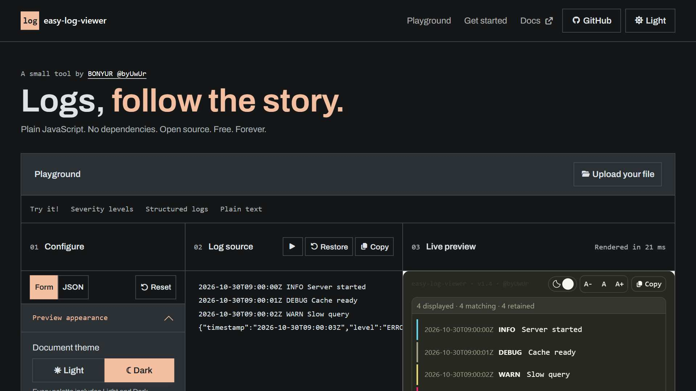

# LOG.view

Browse plain-text or structured logs with severity colors, search, timestamps, and expandable details. Append new entries as they arrive.



## Index

1. [Quick start](#quick-start)
2. [Try it](#try-it)
3. [Downloads](#downloads)
4. [API and options](#api-and-options)
5. [Themes](#themes)
6. [Checks and releases](#checks-and-releases)
7. [Related projects](#related-projects)
8. [License](#license)

## Quick start

```html
<link href="https://cdn.jsdelivr.net/gh/byuwur/log.view@latest/log.min.css" rel="stylesheet" />
<script src="https://cdn.jsdelivr.net/gh/byuwur/log.view@latest/log.min.js" defer></script>
<div id="viewer" data-theme="light"></div>
<script>
  document.addEventListener("DOMContentLoaded", () => {
    const logs = byLOGviewer(document.getElementById("viewer"), "INFO Server ready");
    logs.append({ level: "error", timestamp: "2026-10-30T09:00:00Z", message: "Request failed", status: 503 });
  });
</script>
```

Pin a published tag in place of `@latest` for a fixed version.

### Offline use and Content Security Policy

The renderer loads no remote scripts, fonts, or styles. Local library files work without a CDN, including in a `file://` host. Host optional `log.themes.css` locally for extra palettes. The online playground and exported CDN starter still require internet access; a local starter requires all referenced files beside it. Playground fetches and clipboard permissions remain subject to browser restrictions.

Allow the script and style origins in your CSP. Authorize inline initialization and custom theme CSS separately, or move them into local files. The controls use static HTML templates and do not support enforced Trusted Types.

## Try it

[Playground](https://log.byuwur.co/)

The library contains no tracking. The [privacy policy](https://byuwur.co/privacy/dotview) and [cookie policy](https://byuwur.co/cookies/dotview) apply only to the hosted landing page and playground.

Open [index.html](index.html) locally. Its host assets use the network. Exported starters use the default settings. The playground accepts local files up to 30 MiB.

## Downloads

[ZIP](https://github.com/byuwur/log.view/releases/latest/download/log.view.zip) · [Minified ZIP](https://github.com/byuwur/log.view/releases/latest/download/log.view.minified.zip)

## API and options

1. [Input, parsing, and API](#input-parsing-and-api)
2. [Log options](#log-options)
3. [Shared controls and lifecycle](#shared-controls-and-lifecycle)

### Input, parsing, and API

`byLOGviewer(element, input?, options?)` accepts text, a record, or an array of strings/records. Omitted input uses the target's text. Text splits on CR/LF/CRLF; a trailing newline adds no entry. Empty strings have no entries. JSON object lines are parsed; malformed JSON stays plain text.

The default parser recognizes a leading ISO-like timestamp with optional severity, or a leading severity with optional brackets. Supported levels: TRACE, DEBUG, INFO, WARN/WARNING, ERROR, and FATAL/CRITICAL. Other formats stay UNKNOWN; words inside messages are not treated as severity.

Timestamps retain their input text without timezone conversion. Text after the timestamp/severity becomes the message.

Records use `message`/`msg`, `level`/`severity`, and `timestamp`/`time`. Other own properties appear in Details. Missing messages display `(structured entry)`. Object messages/details become indented JSON; bigint values become strings and cycles become `[Circular]`. Original text/record JSON is retained for individual copy and source copy.

`byLOGviewer.parse(entry)` exposes the default single-entry parser and returns `{ message, level, timestamp, details? }`. Invalid entry types throw `TypeError`.

The controller also exposes `append(batch): Promise<boolean>`. Batches are queued in order and committed atomically. A failed batch displays an error, preserves earlier entries, and resolves `false`; later valid batches can recover.

Only the newest `maxEntries` are retained. Calling `append()` after disposal resolves false. The initial `ready` Promise belongs to the initial batch.

```javascript
const logs = byLOGviewer(target, []);
await logs.ready;
const accepted = await logs.append({ level: "info", message: "Upload complete" });
// accepted is false if the batch failed or this instance was disposed.
logs.destroy(); // Call when the host panel is removed.
```

### Log options

| Option | Default | Behavior |
| --- | --- | --- |
| `layout` | `"inline"` | `"inline"` keeps metadata and message together when they fit; `"stacked"` places the message below its timestamp and severity. Invalid values use `"inline"`. |
| `parser` | built-in | Synchronous `(entry, index) => ({ message, level, timestamp, details })`; return null to skip. Index counts committed input entries, including skipped ones. A thrown error discards the batch; `append()` resolves `false`. |
| `search` | `false` | Case-insensitive substring search over source and parsed fields. |
| `autoScroll` | `false` | Show newest matching entries and scroll the internal log region to the bottom after changes. |
| `batchSize` | `200` | Entries shown initially/per Load more, integer 1-1000; invalid values use 200. |
| `maxEntries` | `10000` | Retained history size, integer 1-100000; invalid values use 10000. Oldest entries are discarded. |

Search and exact severity filtering combine with AND. Auto-scroll shows the newest display window; without it, Load more reveals older-to-newer entries.

The viewer does not tail files or open connections. Pass complete entries to `append()`; text chunks are not joined. Supply each stack trace or multiline event as one array string or record. Use `parser` for syslog, custom timestamps, or numeric severity conventions.

Text batches are limited to 10 million characters and 100,000 entries. Parsing/filtering yield; record serialization and rendering each display batch are synchronous. History is bounded by entry count, not bytes; bound individual record sizes in your application. Source copy includes retained hidden entries, but cannot recover discarded history.

### Shared controls and lifecycle

| Option              | Default     | Behavior                                                                                                                                                   |
| ------------------- | ----------- | ---------------------------------------------------------------------------------------------------------------------------------------------------------- |
| `animations`        | `true`      | Brief control/disclosure motion and background fades; overrides the system motion preference.                                                              |
| `appearAnimation`   | `false`     | Fade the viewer in on each render when `animations` is enabled. Initial rendering remains immediate by default.                                            |
| `toolbar`           | `true`      | Show the viewer header; secondary tools are configured separately.                                                                                         |
| `credits`           | `true`      | Show attribution in the header.                                                                                                                            |
| `displayContainer`  | `true`      | Show the content panel frame and inner horizontal padding. `false` also hides status information.                                                          |
| `statusBar`         | `true`      | Show counts and metadata when `displayContainer` is true. With `statusBar: false`, loading and empty results remain visible; errors always remain visible. |
| `levelFilter`       | `false`     | Show the severity filter.                                                                                                                                  |
| `autoScrollControl` | `false`     | Show the auto-scroll switch; autoScroll also works without it.                                                                                             |
| `copyEntries`       | `false`     | Show a copy button on each entry.                                                                                                                          |
| `details`           | `true`      | Show structured entry details.                                                                                                                             |
| `loadMore`          | `true`      | Load entries in batches; false displays every matching entry.                                                                                              |
| `theme`             | Container   | Initial `"light"` or `"dark"` mode class.                                                                                                                  |
| `palette`           | Container   | Initial `data-theme` palette, including custom CSS names.                                                                                                  |
| `fontSize`          | Container   | Number in rem or a CSS size such as `"1.25em"` or `"20px"`; bounded to `0.5rem`-`3rem`.                                                                    |
| `themeToggle`       | `true`      | Show the theme toggle.                                                                                                                                     |
| `fontSizeControls`  | `true`      | Show text-size controls.                                                                                                                                   |
| `copyButton`        | `true`      | Show full source copy button.                                                                                                                              |
| `controlsSize`      | `"regular"` | `"xs"` (0.5rem), `"small"` (0.7rem), `"regular"` (0.875rem), `"large"` (1rem), or `"xl"` (1.25rem); invalid values use `"regular"`.                        |
| `controlsCompact`   | `true`      | Keep credits beside controls; `false` stacks them. Wraps as needed.                                                                                        |
| `controlsPosition`  | `"top"`     | Sticky `"top"` or `"bottom"` toolbar; invalid values use `"top"`.                                                                                          |

The controller exposes `ready`, `append()`, and `destroy()`. `ready` resolves `true` after initial rendering, or `false` on a displayed data error or cancellation. Invalid targets/options can throw synchronously.

`ready` describes the initial render only. Await each later `append()` call's returned promise to track that batch.

Re-rendering disposes the previous instance. `destroy()` cancels pending work and clears the target only if the instance still owns it. Duplicate script loads preserve the API. Read its version with `byLOGviewer.VERSION`.

Input is displayed as text, never executed. Style `.byLOGdocument` with `--by-view-bg`, `--by-view-text`, `--by-view-muted`, `--by-view-border`, `--by-view-accent`, `--by-view-alt`, `--by-view-string`, and `--by-view-literal`. The container uses system-ui; source/tree content uses monospace. Override the class or target's inline font/size as needed.

Copy requires clipboard permission in a secure context.

Requires a modern browser with async functions, WeakMap, ES2022 array methods, and CSS variables. The browser suites can run in Chromium, Firefox, and WebKit (see Checks).

`--by-view-content-font` and `--by-view-line-height` set source/tree typography.

The playground disables header-only settings while Viewer header is off, preserving their values. Appearing animation is disabled while Animations is off.

Use `toolbar: false` to hide the header, or disable `credits`, `themeToggle`, `fontSizeControls`, and `copyButton` individually. Content actions such as search and format-specific buttons use their own options.

Controls use monospace by default; override `--by-view-controls-font` to change it.

## Themes

Use `theme` for light or dark mode and `palette` for the color scheme. Monokai, GitHub, Solarized and High Contrast are built in. Load [log.themes.css](log.themes.css) after the base stylesheet for the other palettes.

Options override container settings. Omit an option or pass `null` to keep its current value. Numeric `fontSize` uses rem. CSS sizes such as `20px` also work within the `0.5rem` to `3rem` range. Invalid appearance values throw `RangeError` before replacing the document.

```html
<div id="viewer" class="dark" data-theme="github"></div>
```

Use **Copy CSS** in the playground to export appearance settings. Set `--by-view-document-bg` for the outer background and `--by-view-container-bg` for panels and controls. Define custom palette variables on the component’s mode class and `[data-theme]` selector. For example:

```css
.byLOGdocument.dark[data-theme="my-ocean"] {
  --by-view-bg: #102a43;
  --by-view-text: #f0f6fc;
}
```

### Palette names

`monokai`, `github`, `solarized`, `high-contrast`, `dracula`, `darcula`, `nord`, `catppuccin`, `catppuccin-frappe`, `catppuccin-macchiato`, `rose-pine`, `rose-pine-moon`, `gruvbox`, `gruvbox-material`, `tokyo-night`, `tokyo-storm`, `tokyo-moon`, `one`, `material`, `material-ocean`, `night-owl`, `synthwave`, `ayu`, `everforest`, `kanagawa`, `selenized`, `vscode`, `monokai-dimmed`, `discord`, `slack`, `bonyur`, `sakura`, `bubblegum`, `candy`, `rose-gold`, `lavender`, `cyberpunk`, `sunset`, `volcano`, `amber`, `terminal`, `paper`, `ink`, `ocean`, `forest`, `mint`, `ice`, `sepia`.

High Contrast text colors target at least [7:1 contrast](https://www.w3.org/WAI/WCAG22/Understanding/contrast-enhanced.html), with [3:1 contrast for control boundaries and focus cues](https://www.w3.org/WAI/WCAG22/Understanding/non-text-contrast.html). Check contrast again when you override colors.

Legacy integrations can use `#byVIEWtheme` or a detected `log.light.css` / `log.dark.css` link. The toggle keeps its path, query, and hash and updates viewers sharing the link. Explicit container themes stay independent. Separate theme files are no longer shipped; retain your hosted legacy files to use this alternative.

## Checks and releases

Use Node.js 22+ and run these commands from the repository root. For playground checks, place sibling checkouts of `spa.js` at `v20.16`, `code.view` at `v2` next to this repository.

```sh
npm --prefix .github ci --ignore-scripts --no-audit --no-fund
node .github/node_modules/playwright/cli.js install chromium
export NODE_PATH="$PWD/.github/node_modules"
node --test --test-concurrency=1 __tests__/rendering.cjs __tests__/playground.cjs
node .github/scripts/build.mjs --tag v0.0.0-local
npm --prefix .github run release:test
```

In PowerShell, replace the `export` line with `$env:NODE_PATH = "$PWD/.github/node_modules"`. [CI](.github/workflows/rendering.yml) runs Chromium automatically; choose Firefox or WebKit on a manual run.

The [release workflow](.github/workflows/release.yml) tests the regular and minified ZIPs. Both contain the runtime files, README and license. The build manifest records the version and source commit. The local build writes `dist/assets/` and `dist/RELEASE_NOTES.md`. Use `--offline` for local minification. Publish by pushing a version tag matching the library’s `VERSION` (for example, `v2` for version 2).

## Related projects

[CODE.view](https://github.com/byuwur/code.view) · [CSV.view](https://github.com/byuwur/csv.view) · [DIFF.view](https://github.com/byuwur/diff.view) · [JSON.view](https://github.com/byuwur/json.view) · [MD.edit](https://github.com/byuwur/md.edit) · [MD.view](https://github.com/byuwur/md.view) · [XML.view](https://github.com/byuwur/xml.view) · [YAML.view](https://github.com/byuwur/yaml.view)

## License

MIT (c) 2026 Andres Trujillo [Mateus] byUwUr. See [LICENSE](LICENSE.md).
